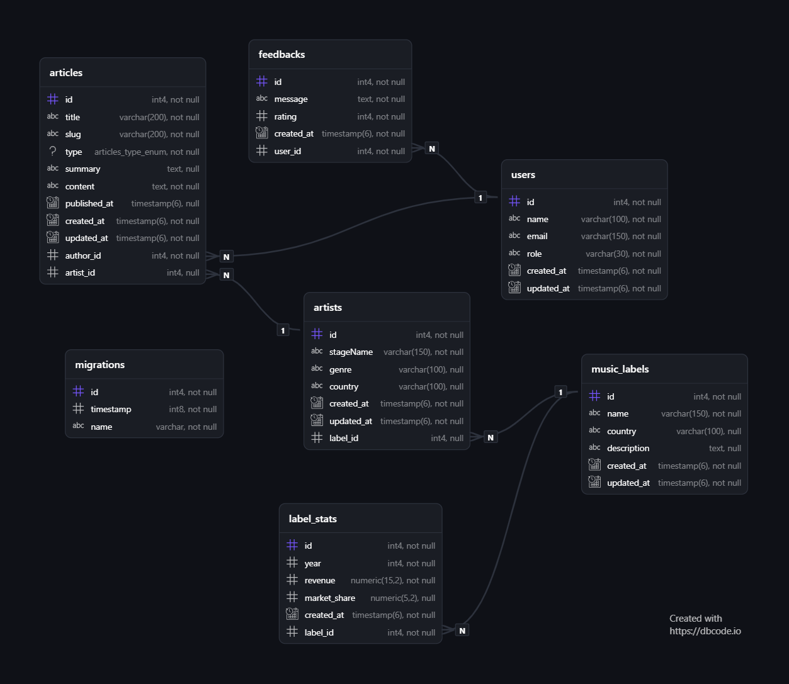

## Доменная область

### **Mononews** - это инфорамционная платформа посвященная музыкальной индустрии. Она позволяет публиковать материалы об исполнителях и группах, музыкальных лейблах, событиях и других новостях в сфере музыки.

## Сущности доменной модели

"User" - пользователь платформы, включает в себя: имя, адрес эл. почты, роль пользователя, дата создания и дата последнего изменения.

"Article" - новостная публикация, основные атрибуты: заголовок, уникальный адрес публикации, тип статьи, краткое описание, содержимое, дата публикации, создания и последнего изменения. Каждая статья имеет одного автора, который является пользователем платформы.

"Artist" - музыкальный исполнитель или группа. Сценическое имя, музыкальный жанр, страна, дата создания записи и последнего изменения.

Исполнитель может быть связан с нескольими статьями и ожет принадлежать музыкальному лейблу.

"MusicLabel" - музыкальный лейбл. Он включает в себя название музыкального лейбла, страну, описание, дату создания и последнего изменения.

"LabelStat" - показатели музыкального лейбла за определенный год, которая состоит из самого года, дохода, доли рынка и даты создания записи.

"Feedback" - отзывы пользователей о работе платформы. Основные атрибуты: текст сообщения, оценка и дата создания отзыва.

## Связи между сущностями

"User" - "Article" = один пользоваель - несколько статей  
"User" - "Feedback" = один пользователь - несколько отзывов  
"Artist" - "Article" = один исполнитель - несколько статей посвящено  
"MusicLabel" - "Artist" = один муз. лейбл - несколько исполнителей  
"MusicLabel" - "LabelStat" = один муз. лейбл = несколько стат. записей за разные года  

## ER-диграмма

